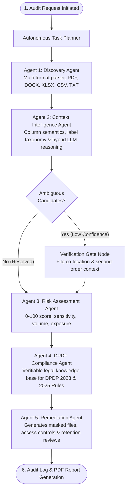

# PRIVESCAN AI
### Agentic AI-Powered Data Privacy Discovery & DPDP Compliance Auditor

> **Discover. Understand. Protect.**  
> An autonomous multi-agent system designed for India's **Digital Personal Data Protection Act, 2023** and **Digital Personal Data Protection Rules, 2025**.

---

## 1. Problem Statement & Executive Summary

Organisations store personal data across shared network folders, email attachments, and historical CSV/Excel exports without visibility. India's **Digital Personal Data Protection Act, 2023 (DPDP Act)** imposes statutory penalties up to **₹250 Crores** for failing to institute reasonable security safeguards against personal data breaches (Section 8(5), Schedule 1).

**The Core Challenge:**
- **Manual privacy audits do not scale** across thousands of files.
- **Traditional regex scanners trigger crippling false positives:** pattern-only tools confuse 10-digit customer order numbers (`Order_ID: 9876543210`) with personal phone numbers (`Mobile: 9876543210`).
- **Legal disconnect:** simple PII lists fail to contextualise risk or map findings to enforceable statutory mandates.

**The PRIVESCAN AI Solution:**  
PRIVESCAN AI deploys a genuine **multi-agent LangGraph architecture** that autonomously ingests documents, examines semantic context, resolves ambiguous numerical sequences, evaluates exposure risk (0–100), maps observations to verifiable DPDP provisions, generates cryptographically masked documents, and maintains human-in-the-loop governance.

---

## 2. Multi-Agent Architecture

PRIVESCAN AI is engineered as five specialised autonomous agents orchestrated by a compiled **LangGraph StateGraph** with conditional decision boundaries:



### The 5 Specialised Agents:
1. **Agent 1: Discovery Agent**  
   - Recursively extracts document layout, text tokens, tabular structures, and metadata from PDF, DOCX, XLSX, CSV, and TXT files.
   - Generates structured file inventories and candidate records without modifying source files.
2. **Agent 2: Context Intelligence Agent (Primary Differentiator)**  
   - Distinguishes true personal information from operational identifiers using column labels, field schemas, surrounding text, and Gemini LLM reasoning.
   - Classifies candidates into:
     - `CONFIRMED_PERSONAL_DATA` (e.g., `Mobile_Number: 9876543210`)
     - `LIKELY_PERSONAL_DATA`
     - `NON_PERSONAL_IDENTIFIER` (e.g., `Order_ID: 9876543210`)
     - `AMBIGUOUS` (flagged for review)
   - Performs Verhoeff checksum validation for Indian Aadhaar and Income Tax format validation for Indian PAN.
3. **Agent 3: Risk Assessment Agent**  
   - Quantifies privacy exposure on a configurable **0–100 scale** categorised into **CRITICAL, HIGH, MEDIUM, LOW**.
   - Incorporates statutory sensitivity multipliers (Aadhaar/Bank details > Phone/Email), record volume concentration, and storage exposure factors (historical exports vs secure databases).
4. **Agent 4: DPDP Compliance Agent**  
   - Knowledge-based legal engine grounded in verifiable provisions of India's DPDP Act, 2023:
     - **Section 4:** Grounds for processing (Consent & legitimate uses)
     - **Section 5:** Notice transparency requirements
     - **Section 6:** Consent architecture and withdrawal traceability
     - **Section 8(1):** Data accuracy and completeness obligation
     - **Section 8(5):** Mandatory reasonable security safeguards (₹250 Cr penalty)
     - **Section 8(6):** Personal data breach notification to DPBI
     - **Section 8(7):** Data erasure & retention limitation caps
     - **Section 12:** Right to correction and erasure
     - **Rules 2025:** Technical safeguards & automated pseudonymisation
5. **Agent 5: Remediation Agent & Human Oversight**  
   - Generates physical masked copies of documents in isolated storage (`storage/remediated/`).
   - Recommends file permission lockdowns and statutory retention reviews.
   - **Enterprise Safety Rule:** Original files are never overwritten or deleted automatically; all consequential remediation requires human administrator approval.

---

## 3. Technology Stack

- **Frontend:** Next.js 16 (App Router), React 19, TypeScript, Tailwind CSS, Recharts, Lucide Icons.
- **Backend:** Python 3.13, FastAPI, Pydantic v2, SQLAlchemy, SQLite (production-ready for PostgreSQL migration).
- **Agent Orchestration:** LangGraph (StateGraph, conditional edges, shared agent state).
- **AI & LLM:** Google GenAI SDK (Gemini 2.5 Flash) with transparent, deterministic contextual rule engine fallback.
- **Document Processing:** PyMuPDF (`fitz`), `python-docx`, `openpyxl`, `pandas`.
- **Report Generation:** ReportLab 5.1 (Publication-grade downloadable PDF audit dossiers).

---

## 4. Quick Start & Installation

### Prerequisites
- Python 3.10+ (tested on Python 3.13)
- Node.js 18+ (tested on Node v24 / npm 11)

### 1. Backend Setup
```powershell
# Open terminal in project root
cd "c:\Users\prajw\Desktop\5th Sem\Agentic AI Hackathon"

# Install backend dependencies
python -m pip install -r backend/requirements.txt

# (Optional) Add your Gemini API key in backend/.env:
# GEMINI_API_KEY="your-google-ai-studio-api-key"
# If left blank, PRIVESCAN AI automatically runs on its deterministic contextual engine.
```

### 2. Frontend Setup
```powershell
cd frontend
npm install
npm run build
```

---

## 5. Running the Application

### Option A: Using PowerShell Launch Scripts
In Terminal 1 (Backend):
```powershell
.\start_backend.ps1
```
*(Backend runs on `http://localhost:8000`)*

In Terminal 2 (Frontend):
```powershell
.\start_frontend.ps1
```
*(Frontend runs on `http://localhost:3000`)*

### Option B: Manual Command Line
```powershell
# Terminal 1: Backend
python -m uvicorn backend.app.main:app --host 0.0.0.0 --port 8000 --reload

# Terminal 2: Frontend
cd frontend
npm run start
```
Open your browser at **`http://localhost:3000`**.

---

## 6. Demonstration Scenario & Benchmark Files

PRIVESCAN AI includes **three synthetic demonstration benchmark files** pre-generated in `backend/sample_data/`:

| Benchmark File | File Type | Test Scenario & Misleading Patterns |
| :--- | :--- | :--- |
| **`customer_database.xlsx`** | Excel | Intentionally places 10-digit **`Order_ID: 9876543210`** directly adjacent to genuine 10-digit **`Mobile_Number: 9876543210`**, alongside individual PAN cards and 13-digit Bank Accounts. |
| **`employee_records.pdf`** | PDF | HR master containing employee designations, Indian Aadhaar numbers, PANs, bank accounts, and mobile numbers requiring access controls under Section 8(5). |
| **`old_customer_export.csv`** | CSV | Historical unmonitored export file containing order transactions, transaction references, and unmasked Aadhaar numbers requiring Section 8(7) retention review. |

### Demonstration Walkthrough:
1. Open the web interface at **`http://localhost:3000`**.
2. Click **"Run Demo Audit"** in the top navigation bar or **"Load 3 Synthetic Benchmark Files"** in the Document Scanner tab.
3. The LangGraph multi-agent orchestrator executes in real time:
   - **Discovery Agent:** Discovers files and extracts 72 granular records.
   - **Context Intelligence Agent:** Evaluates `Order_ID` vs `Mobile_Number`.
     - *Result:* `Order_ID: 9876543210` is classified as **`NON_PERSONAL_IDENTIFIER` (98% confidence)** — false positive disproved!
     - *Result:* `Mobile_Number: 9876543210` is confirmed as **`CONFIRMED_PERSONAL_DATA` (97% confidence)**.
   - **Risk Assessment Agent:** Computes risk scores and categories.
   - **DPDP Compliance Agent:** Generates statutory observations mapped to Sections 4, 5, 8(5), 8(7), 12.
   - **Remediation Agent:** Generates cryptographically redacted files in `backend/storage/remediated/`.
4. Inspect the **Privacy Command Center** to see live updated KPI cards and Recharts visualisations.
5. Open the **Findings Explorer** to filter by Risk Level, Category, or Classification, and click **"Investigate"** to open the Finding Dossier.
6. Open the **Remediation Center** to inspect pending actions and approve/reject with compliance officer notes, or download the redacted copy.
7. Open the **Audit Reports** tab and click **"Download Audit PDF Report"** to inspect the executive PDF dossier generated via ReportLab.
8. Open the **Context Engine Playground** tab to test custom inputs and presets interactively.

---

## 7. API Reference

| Method | Endpoint | Description |
| :--- | :--- | :--- |
| `POST` | `/api/audit/session` | Create a new audit session |
| `GET` | `/api/audit/sessions` | List all historical audit sessions |
| `GET` | `/api/audit/session/{id}` | Get audit session details and summary stats |
| `POST` | `/api/audit/upload` | Upload one or multiple documents to a session |
| `POST` | `/api/audit/execute/{id}` | Execute LangGraph multi-agent audit on session files |
| `POST` | `/api/audit/demo` | 1-Click execution of the 3 benchmark demo files |
| `GET` | `/api/audit/stats` | Dynamic dashboard KPI metrics and chart distributions |
| `GET` | `/api/findings` | Filterable findings query (search, risk, category, class) |
| `GET` | `/api/findings/{id}` | Detailed investigation dossier with surrounding context |
| `GET` | `/api/compliance` | List DPDP statutory compliance observations |
| `GET` | `/api/remediation` | List remediation proposals |
| `POST` | `/api/remediation/approve` | Human-in-the-loop approval or rejection of remediation |
| `GET` | `/api/remediation/download/{id}` | Download physically redacted copy of document |
| `GET` | `/api/agents/status` | Real-time status, execution duration, and event logs |
| `GET` | `/api/reports/download/{id}` | Download generated executive PDF audit report |
| `POST` | `/api/context/test` | Live test endpoint for the Context Intelligence Engine |

---

## 8. Automated Verification Tests

An automated verification test script is included in `backend/test_backend.py`:
```powershell
python backend/test_backend.py
```
This script validates:
- Context classification accuracy (`Order_ID` vs `Mobile_Number`)
- End-to-end multi-agent LangGraph execution
- Database persistence of findings, risk scores, and compliance observations
- Physical redacted file creation
- ReportLab PDF generation

---

## 9. Security & Governance

- **Zero Overwrite Guarantee:** Original documents are stored read-only; redactions are saved as separate artifacts.
- **Data Minimisation:** Plaintext sensitive PII is masked by default in all API responses and logs.
- **Configurable LLM Safeguards:** Fully operable without transmitting data to third-party APIs via the built-in deterministic contextual engine.
- **Statutory Traceability:** Mapped against official legal provisions of the Digital Personal Data Protection Act, 2023.

---

**Developed for the Agentic AI Hackathon** | *PRIVESCAN AI — Autonomous Data Privacy Discovery & DPDP Compliance Auditor*

---

## 10. Team Contributions

This project was developed collaboratively by a team of four members, with contributions across AI development, backend engineering, frontend design, compliance analysis, testing, and documentation.

| Team Member | Contributions |
| :--- | :--- |
| **Prajwal Halaharvi** | AI agent architecture, LangGraph orchestration, and context intelligence implementation. |
| **Nandini R** | Frontend development, UI design, dashboard visualisation, and user experience. |
| **PM Shareen** | DPDP compliance research, privacy classification, documentation, and testing. |
| **Krishna Harshith Reddy Devireddy** | Backend development, API integration, database management, risk assessment, and remediation functionality. |

All four members collaborated in developing and integrating PRIVESCAN AI into a unified privacy auditing solution.
